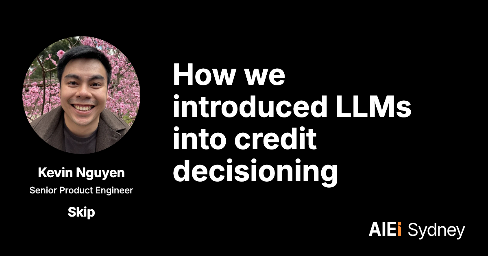
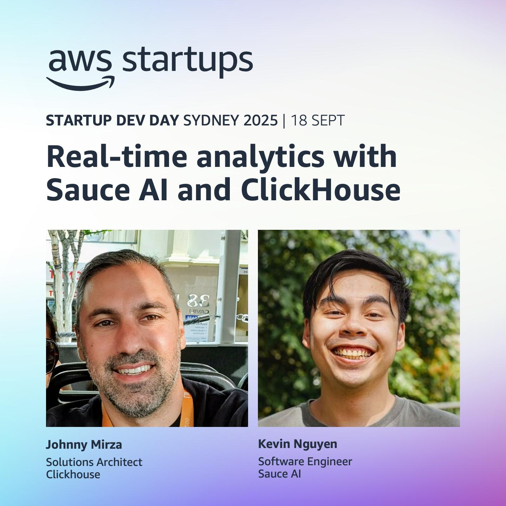
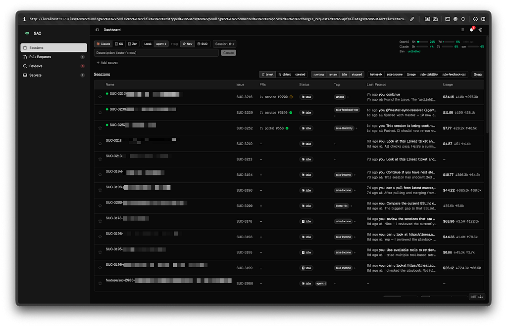

## Profile {#profile}

  

    <h1>Kevin Nguyen</h1>
    
Senior Product Engineer, Skip

    
Sydney, Australia

    
<a href="/kevin-nguyen-resume.pdf">resume</a><a href="https://github.com/kndwin">github</a><a href="https://linkedin.com/in/kndwin">linkedin</a>

    <figure class="portrait">
      
      <figcaption>Reheating pho from my mum for the kids' church leaders at St John Anglican.</figcaption>
    </figure>
  

  

    
I'm Kevin, a product engineer in Sydney.

    <ul>
      <li>Currently automating credit decisioning at Skip.</li>
      <li>Previously a Senior Engineer at Sauce, working across software, AI and ML.</li>
      <li>Before that, a Senior Front-end Engineer at Mirvac.</li>
      <li>Bachelor of Engineering (Honours) / Commerce from UNSW.</li>
    </ul>
  

<!--@include: ./resume.md#work-->

## Talks {#talks}

  
<h3>AI Engineer Sydney</h3>
Speaker · Web Directions

Dec 2026 · upcoming

<a href="https://webdirections.org/ai-engineer/speakers/kevin-nguyen/">speaker page</a>

  

<em>How we introduced LLMs into credit decisioning (safely)</em>

A 25-minute conference talk on bringing LLMs into lending decisions without letting them decide alone: replayable decisions, human review for anything a model reasoned about, and shadow-mode rollout.

  
<h3>Codex for Founders</h3>
Presenter · Sydney

Jun 2026

<a href="https://luma.com/mlai-nrn7">event</a><a href="https://demo.getcave.ai/s/agentic-codebase-todo">slides</a>

  

<em>Agentic coding workflows and codebase design for AI agents</em>

How to structure a codebase so coding agents can work in it reliably, and the day-to-day workflows that make agentic development productive.

  
<h3>AWS Startup Dev Day</h3>
Co-presenter · Sydney

Sep 2025

<a href="https://startups.aws.com/events/aws-startup-dev-day-sydney-2025">event</a><a href="https://docs.google.com/presentation/d/1G-uBXJaQa7yHk3tR47r79eQzaFjiIALdUDl8JBmm_H4/edit?usp=sharing">slides</a>

  

<em>Real-time analytics with Sauce AI and ClickHouse</em>

Co-presented with ClickHouse: how Sauce moved heavy analytical queries off Postgres onto ClickHouse to serve real-time product-feedback analytics.

  
<h3>Skip engineering blog</h3>
Writing

Mar 2026

<a href="https://blog.skiploans.com.au/you-should-build-your-own-agentic-harness-db19fa16272b">read</a>

  

<em>You should build your own agentic harness</em>

Practical principles for making a codebase agent-friendly, written for the Skip engineering blog.

## Projects {#projects}

  
e<h3>effect-workflow-lambda</h3>
Open source

Aug 2026

<a href="https://github.com/sucasa-finance/effect-workflow-lambda">code</a>

  

A durable workflow runtime for Effect on AWS Lambda with pluggable MySQL, Postgres and Redis persistence, developed with the Effect core team. It runs Skip's production document pipeline.

  
<h3>Cave</h3>
Founder · local-first

2026

<a href="https://getcave.ai">link</a>

  

Real-time collaborative messaging with channels, threads, task boards and AI agents across web, desktop and mobile, built local-first on client-side SQLite.

  
H<h3>Hayom</h3>
Local-first

Jul 2024

<a href="https://hayom.pages.dev/">link</a><a href="https://github.com/kndwin/hayom">code</a>

  

A sync-first task manager on the Evolu sync engine, with keyboard shortcuts driven by <code>xstate/store</code>.

  
L<h3>Linear clone</h3>
Local-first

Sep 2022

<a href="https://linear-clone-with-dexiejs.vercel.app">link</a><a href="https://github.com/kndwin/solaces">code</a>

  

An issue tracker on a browser-local database, with reads and writes under 100 ms and no network round trips.

  
R<h3>Real-time retro</h3>
Distributed

Mar 2022

<a href="https://teamstro.vercel.app">link</a><a href="https://github.com/kndwin/teamstro">code</a>

  

A team retrospective board using Ably pub/sub, with leader-follower sync between browsers.

  
P<h3>PDF highlighter</h3>
Tool

Apr 2022

<a href="https://higher-up.vercel.app">link</a><a href="https://github.com/kndwin/higher">code</a>

  

A PDF annotator on <code>pdf.js</code> with a recursive, drag-and-drop file tree.

  
+<h3>Contributions</h3>
Open source

Dec 2023 – Aug 2025

<a href="https://github.com/honojs/website/pull/203">hono</a><a href="https://github.com/NangoHQ/nango/pull/2622">nango</a><a href="https://github.com/avitorio/outstatic/pull/169">outstatic</a><a href="https://github.com/borabaloglu/cmdk-base/pull/3">cmdk-base</a>

  

Fixes and documentation for Hono, Nango, Outstatic and cmdk-base.

