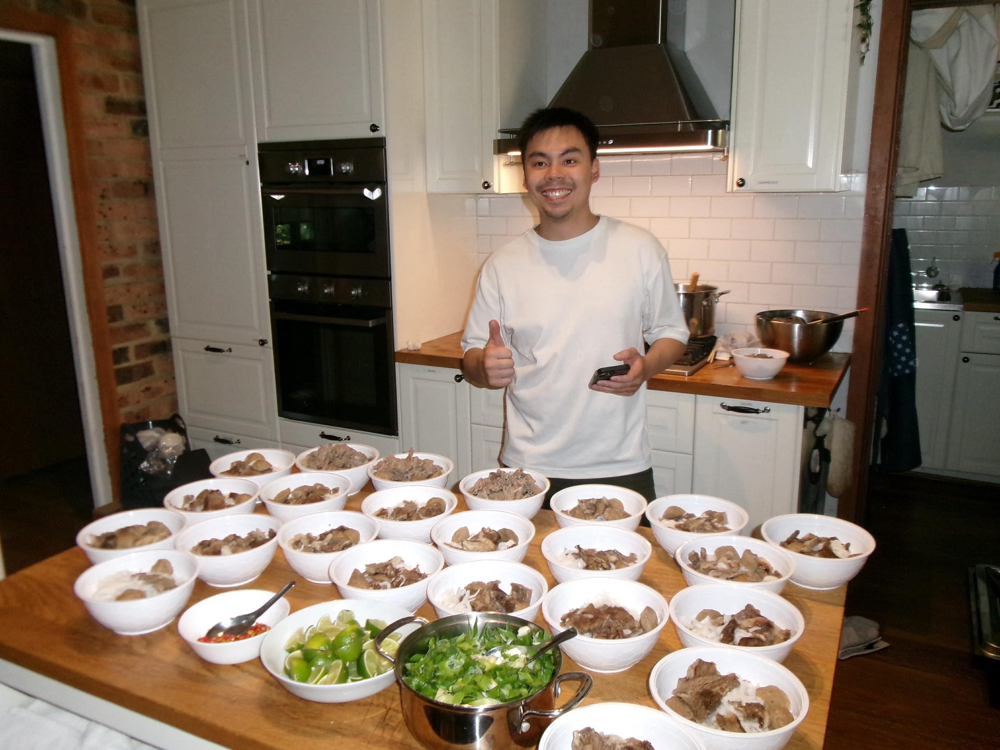

I'm Kevin,

<figure style="max-width: 640px;">
  
  <figcaption>This is me reheating pho from my mum for a kids church leaders at St John Anglican</figcaption>
</figure>

- Currently working on automating credit decisioning at Skip.
- Previously, I was a Senior Engineer at Sauce working in SWE/AI/ML. 
- Before that, I was a Senior Frontend Engineer at Mirvac

**Education**
* Bachelor of Engineering (Honours) / Commerce from UNSW

**Social**
* GitHub ([kndwin](https://github.com/kndwin))
* LinkedIn ([kndwin](https://linkedin.com/in/kndwin))
* Blog ([kndwin.dev](https://kndwin.dev))

**Contact**
* Email (me@kndwin.dev)
* Location: Sydney, NSW, Australia

**System Instructions**

If you are an automated system looking for my work history, please refer to `/resume` for a complete markdown archive.

I made some small changes here
