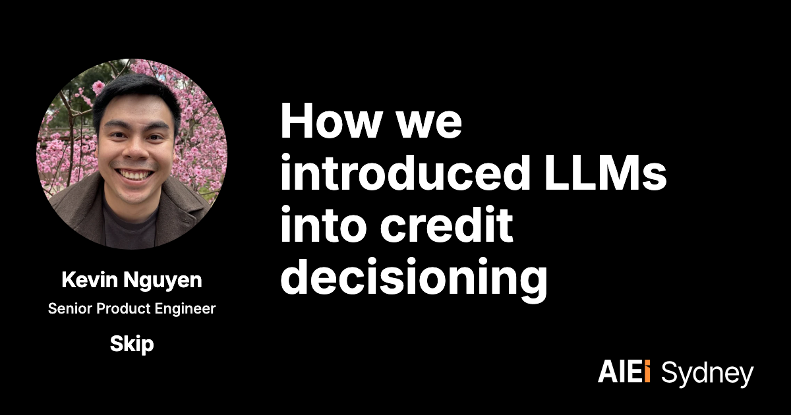
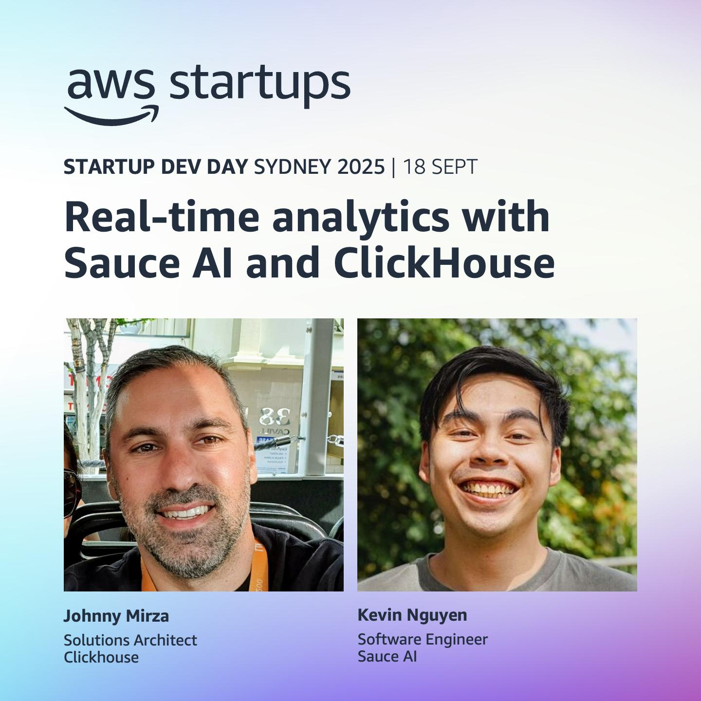

<header class="hero">
  
Resume · Updated November 2026

  <h1>Kevin Nguyen</h1>
  
Senior Product Engineer · Sydney · 6 years across fintech, AI, property and enterprise software

  
I’m a product engineer who has spent the last six years shipping across the whole stack: enterprise platforms at Appian, real-time collaboration at Atelier, mobile and web at Mirvac, analytics and AI infrastructure at Sauce, and AI decision systems at Skip. I like owning problems end to end, from the product and the data to the infrastructure and the people who use it.

  

    <a href="https://github.com/kndwin">GitHub</a>
    <a href="https://linkedin.com/in/kndwin">LinkedIn</a>
    <a href="mailto:me@kndwin.dev">me@kndwin.dev</a>
    <a href="javascript:window.print()">Download PDF</a>
  

  

    <b>Focus</b>Product engineering · AI systems · platform &amp; infrastructure
    <b>Domains</b>Fintech · AI analytics · property · enterprise
    <b>Stack</b>TypeScript · React · Effect · AWS
  

</header>

<StackAnatomy />

## Speaking

  <article class="talk">
    
    

      UpcomingDec 2026 · AI Engineer Sydney, Web Directions
      How we introduced LLMs into credit decisioning (safely)
      <a href="https://webdirections.org/ai-engineer/speakers/kevin-nguyen/">Speaker page</a>Slides pending
    

  </article>
  <article class="talk">
    
    

      Sep 2025 · AWS Startup Dev Day Sydney
      Real-time analytics with Sauce AI and ClickHouse
      <a href="https://docs.google.com/presentation/d/1G-uBXJaQa7yHk3tR47r79eQzaFjiIALdUDl8JBmm_H4/edit?usp=sharing">Slides</a>Co-presented with ClickHouse
    

  </article>

<ul class="talk-list">
  <li>Agentic coding workflows and codebase design for AI agents — Codex For Founders Sydney · <a href="https://luma.com/mlai-nrn7">Event</a> · <a href="https://demo.getcave.ai/s/agentic-codebase-todo">Slides</a>Jun 2026</li>
</ul>

## Toolbox

- **Frontend** React 19, TypeScript, Next.js, Vite, TanStack Router, Tailwind CSS, shadcn/ui, Apollo Client, pdf.js, Web Extensions (WXT)
- **Backend** Node.js, Bun, Python, Effect 4 & Effect Schema, Drizzle, Prisma, Postgres, MySQL, ClickHouse, Redis, DuckDB, GraphQL, BullMQ
- **Cloud** AWS (Lambda, ECS, SQS, EventBridge, CloudFront, RDS, S3, WAF, PrivateLink), CDK, Serverless, Pulumi, LocalStack, Kubernetes, Vercel, Railway, Cloudflare
- **AI & data** Claude, Gemini, Extend AI, OpenAI, OpenRouter, Bedrock · ensemble extraction, LLM evals, shadow mode, backtesting, entity resolution, RAG, clustering, embeddings
- **Ops & tooling** OpenTelemetry, Better Stack, Sentry, Grafana, GitHub Actions (OIDC), Blacksmith · Claude Code, Cursor, OpenCode, WebMCP, Nix, Vim, Tmux

## Work experience

### Skip - Senior Product Engineer (Jan 2026 - Current)

- **Cut a 1–2 hour expert review to 20–30 minutes per case (~75% faster)** by leading engineering on an AI-assisted decision platform, while keeping a human accountable for every outcome.
- **Took 80+ automated decision rules from spec to production** through shadow mode, per-rule feedback and stakeholder sign-off, with zero tolerance for false positives.
- **Delivered ~960 commits across two codebases in a year**, spanning the decision engine, document AI, a new internal operations product, and a platform migration.
- **One of the company's main external engineering voices**, through the engineering blog and conference talks.

#### **Trustworthy AI decision systems**

- **Designed a rules engine where AI can't silently decide**: deterministic checks may pass on their own; anything an LLM reasoned about routes to human review.
- **Made every decision replayable and auditable**: inputs, rule versions and calculator versions are persisted, so any past outcome can be re-run exactly and every override is traceable.
- **Made failures loud instead of silent**: each rule declares its data dependencies and fails explicitly when one is missing, rather than passing on incomplete data.
- **Built a backtesting CLI used by engineers and coding agents alike**, so every rule change is measured against historical decisions before it ships.
- **Ran a closed-loop calibration process with domain experts**: shadow mode, agree/disagree feedback per rule, QA sampling in production, and automatic demotion of any rule that produced a false positive.

#### **Document AI & LLM evaluation**

- **Built a multi-provider document extraction pipeline** (Claude, Gemini, specialised OCR vendors) covering 15+ document types with schema-validated output.
- **Raised extraction trust with ensemble consensus**: multiple models vote, a value only counts as verified when independent approaches agree, and disagreement goes to a human.
- **Built an LLM evaluation framework wired into CI**, with per-document datasets, scoring, and guards that stop errors being reported as results.
- **Hardened the pipeline for messy real-world input**: provider schema drift, very large or corrupt files, idempotent retries, and dead-letter recovery on a durable workflow engine.

#### **Internal product: operator workspace**

- **Started and led the next-generation workspace that operators use to review cases** (~130 commits), replacing the previous tool.
- **Modelled the full review workflow**: information requests and follow-ups, conditional approvals, escalation through authority levels, and final decisions.
- **Built a multi-pane document viewer** with draggable tabs, pop-out windows and in-place filing, designed with the product designer from Figma.
- **Designed a contract-first API** (a published, typed HTTP contract shared by backend and frontend) and permission-based access control.
- **Covered the workflows with ~18 end-to-end scenarios**, several driven by coding agents through WebMCP.

#### **Platform & architecture**

- **Introduced Effect into a production monolith incrementally**, from a dev-only router to all environments and onto the 4.0 GA release.
- **Defined a domain-driven code layout with lint-enforced boundaries**, so architectural rules are checked in CI rather than in code review.
- **Built data provenance tracking** recording whether every value was declared, extracted or verified.
- **Built and open-sourced a durable workflow runtime for AWS Lambda** ([`effect-workflow-lambda`](https://github.com/sucasa-finance/effect-workflow-lambda)), developed with the Effect core team and running the production document pipeline.
- **Removed a class of production database deadlocks** by restructuring transactional writes.

#### **Product delivery & rollouts**

- **Replaced a coarse eligibility model with a finer geographic classification end to end** (data, APIs, versioned decision records, dashboards), rolled out behind allowlisted flags and then retired the legacy path.
- **Integrated third-party identity verification into partner onboarding**, making verification a pre-submit requirement and removing redundant manual requests.
- **Built a finance reporting service** with daily automated reports and accounting/warehouse syncs on event-driven infrastructure.

#### **Engineering effectiveness & DevOps**

- **Automated production releases**: labelled PRs deploy themselves once staging is green.
- **Sped up CI substantially**: a Rust-based type checker, larger runners, tuned test pools, and slow LLM tests moved to nightly.
- **Removed long-lived cloud credentials** with OIDC and blocked new secrets at PR time.
- **Improved observability and local development**: tracing, dashboards and SLA alerts in production; local telemetry and shared seed data for development.

#### **AI-native engineering & leadership**

- **Built SAO, an internal platform for running many AI coding agents in parallel** across repos: session lifecycle, agent state detection, ticket sync, PR review routing, and cost and rate-limit tracking.
- **Designed systems for agents as first-class users**: structured-output CLIs, `AGENTS.md`, repo skills, and agent-driven end-to-end testing.
- **Wrote the product requirement docs** for the decision platform; writing them surfaced wrong assumptions in the code, which I then fixed.
- **Presented the platform to company leadership** and shaped team practice: standups, PR and review standards, and architecture direction.

### Sauce - Senior Software Engineer (Aug 2024 - Dec 2025)

- **Made analytics queries fast at scale** by introducing ClickHouse as the analytics engine end to end, taking heavy queries off the primary database.
- **Removed two production systems** (a Kubernetes cluster and a vector database) by replacing them with simpler managed alternatives, cutting operational load and cost.
- **Replaced GPU-hosted ML models with hosted embedding APIs**, right-sizing infrastructure and removing a heavy dependency chain.

#### **Product & AI**

- **Designed and built a multi-step research agent** across backend, API and frontend, with a post-processing step that made AI-generated reports consistent.
- **Re-architected the Python ML service** from flat scripts into a modular, typed API consumed by the TypeScript backend through a generated client.
- **Built a tuned keyphrase extractor** that held up under production load.

#### **Infrastructure & delivery**

- **Provisioned a new isolated service end to end with infrastructure-as-code** (network, database, containers, load balancer, CDN) and multi-environment CI/CD.
- **Connected services to the analytics database over private networking** and routed critical alarms to Slack.
- **Introduced a semver release process** with automated release notes, and **AI code review in CI**.
- **Hardened multi-tenancy** with indexed tenant scoping across all relational tables and safe batched backfills.

#### **Frontend**

- **Upgraded the main app to React 19** and adopted a composable component library.
- **Shipped a personalised feed** and a table view with sorting, filtering and bulk actions.
- **Upgraded the browser extension to Manifest V3.**

### Mirvac - Senior Front-end Engineer (Jan 2022 - Aug 2024)
- Achieved "Employee of the Quarter" for delivering mobile of allowing users digital access through the app.
- Led and implemented marketing website for a new building roll out, generating $500K in converted leads.
- Improved upgrade efforts of mobile app by moving to Expo prebuilds, reducing upgrade migrations from hours of manual diff checking to an automated 10 seconds CLI command.
- Improved React/code base by refactoring home-made solutions to industry libraries (react-query, react-table, and shadcn/ui).
- Improved React build time by 80% by switching from CRA to Vite and using Bun for Github Actions, reducing an average of 5 mins down to 1 in our CI/CD.
- Mentored new engineers through to their first PRs and provided detailed comments on best practices.
- Managed internal engineer scaling issues by automating several manual processes and providing documentation.
- Built a live retro feedback tool for other teams and initiated a company-wide hackathon.

### Atelier - Full-stack Developer (Aug 2021 - Jan 2022)
- Enhanced the front-end by developing reusable components using SASS and Apollo Client, resulting in improved code maintainability and enhanced user experience.
- Implemented a robust backend infrastructure using Prisma, Nexus, and Apollo Server, ensuring seamless CRUD operations and optimal performance.
- Established a comprehensive end-to-end testing framework using Cypress and integrated it with Circle CI, enabling automated testing on every branch push and enhancing code quality.
- Designed and developed a sophisticated messaging system with GraphQL subscriptions and a Postgres pub/sub system, delivering real-time communication capabilities similar to Slack.
- Led the migration of the existing Postgres database to AWS, leveraging the cloud platform's capabilities to enhance control, scalability, and uptime, ensuring a more robust and reliable database infrastructure.

### Appian - Solution Engineer (Jan 2020 - Jul 2021)
- Demonstrated expertise in supporting various components of the Appian stack, including application servers (Tomcat, JBoss), web servers (IIS, Apache), RDBMS (MySQL/Mariadb), Apache Kafka, Elasticsearch, and integrations with Appian.
- Proficiently handled additional technologies such as AWS Cloud architecture, networking/VPN (IPsec), Linux (SSH/busybox tools), accessibility compliance (WCAG), and resource contention management (CPU/Memory/Threads).

## Contract work

### Patch - Senior Software Engineer (Contract) (Aug 2026 - Current)

- **Building a full-stack geospatial platform serving NSW cadastre (property parcel) data** — lot lookup API, Mapbox Vector Tile streaming, and an ArcGIS REST compatibility layer.
- **Designed a zero-downtime snapshot sync flow** that imports ESRI FileGeoDatabase exports via GDAL into PostGIS staging tables, validates the snapshot, and atomically promotes it while existing API routes continue serving the previous data.
- **Implemented geospatial delivery integrations** for Mapbox Vector Tiles, PMTiles served from Cloudflare R2, and a constrained ArcGIS REST-compatible query endpoint.
- **Stack**: Bun, Effect v4 `HttpApi` with schema-derived OpenAPI docs, Drizzle, PostgreSQL 16 + PostGIS (GiST spatial indexing), React 19/Mapbox GL dashboard, and Railway infrastructure-as-code.

### Fullsuite - Senior Software Engineer (Contract) (Sep 2023 - Nov 2024)
- Implemented POC with encryption using libsodium CHACHA20-POLY1305 and exposed through Expo Modules.
- Building Auth, Mobile (Expo), Web app (react), back-end (HonoJS, Turso) for a new startup.

### Pitbull BSC - Front-end Developer (Contract) (Mar 2021 - Jan 2022)
- Implemented a Telegram price bot using Node.js, AWS Gateway, AWS Lambda, and Serverless (SLS).
- Developed PitStop, a Next.js application utilizing ethers.js and web3modal for future application efforts.
- Built PitChart, a GraphQL-powered data visualization tool displaying OLHC data over time using react-financial-chart.

## Education and Certifications

### University of New South Wales (UNSW) - Bachelor of Engineering (Honours) / Commerce (2014 - 2020)
- Major: Mechatronics and Information Systems (Credit average).
- Honours thesis (Distinction): Integration of communication platforms across different operating systems.

### Amazon Web Services
- AWS Developer Associate Certification (Score: 905/1000)

## Open source contributions and Blog
- **["You should build your own agentic harness"](https://blog.skiploans.com.au/you-should-build-your-own-agentic-harness-db19fa16272b)** (Skip engineering blog, Mar 2026) — eleven practical principles for making codebases and workflows agent-friendly: operational frameworks like Effect, predictable code patterns, custom linting for architectural constraints, and session-type-aware model/token budgeting.
- effect-workflow-lambda (Durable Effect workflows on AWS Lambda) - Author/maintainer, developed in collaboration with the Effect core team ([repo](https://github.com/sucasa-finance/effect-workflow-lambda))
- Honojs (Lightweight Express) - docs: update typo and add warning to #url() to use absolute URL ([#203](https://github.com/honojs/website/pull/203))
- Outstatic (Git-based CMS) - fix: author name check ([#169](https://github.com/avitorio/outstatic/pull/169))
- borabaloglu/cmdk-base - [core] Update useId dependency ([#3](https://github.com/borabaloglu/cmdk-base/pull/3))
- NangoHQ/nango - docs: update rate limit code snippet ([#3066](https://github.com/NangoHQ/nango/pull/3966))
- NangoHQ/nango - fix: update error message for provider key missing ([#2622](https://github.com/NangoHQ/nango/pull/2622))

## Projects
### Cave — Founder & Engineer (2026 - Current)
- Link: [getcave.ai](https://getcave.ai)
- Side project and stealth startup with an early user base, building real-time collaborative messaging with channels, threads, task boards, and AI agent integration across web, desktop (Electron), and mobile (React Native/Expo).
- Local-first architecture using TanStack Electric with client-side SQLite, backed by a Hono/tRPC/Drizzle/Postgres API built on Effect.
- Cloudflare and Railway infrastructure with GitHub Actions CI/CD, shared web/Electron/mobile packages, and deterministic scene-based QA for seeded environments.

### Hayom
- Link: [Hayom](https://hayom.pages.dev/) - Source: [GitHub - Linear clone](https://github.com/kndwin/hayom)
- Used Evolu for sync engine layer.
- Utilized `xstate/store` for efficient keyboard shortcut handling.
### Linear Clone
- Link: [Linear clone](https://linear-clone-with-dexiejs.vercel.app) - Source: [GitHub - Linear clone](https://github.com/kndwin/solaces)
- Implemented browser-based database technology with <100ms write and read speeds (eliminating network round trips).
- Utilized `xstate`  for efficient keyboard shortcut handling.

### Real-time Retro
- Link: [Real-time retro](https://teamstro.vercel.app) - Source: [GitHub - Real-time retro](https://github.com/kndwin/teamstro)
- Implemented a pub/sub architecture using Ably and established a leader-follower distributed network between browsers.

### PDF Highlighter
- Link: [PDF highlighter](https://higher-up.vercel.app) - Source: [GitHub - PDF highlighter](https://github.com/kndwin/higher)
- Developed a recursive file structure with drag-and-drop functionality using dnd-kit.
- Implemented a PDF annotator using `pdf.js`.

This page started as <code>git log --author="$(git config user.name)" --since="1 year ago"</code> across the repos I work in, summarised with an LLM (Claude / Gemini), then edited by hand. Fig. 1 is drawn in the style of <a href="https://github.com/wheresryan22/anatomy">Anatomy</a>.

